<div align="center">

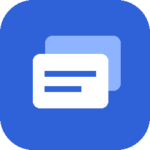

# StudyDesk

**Écris tes cours, prépare tes exposés, crée tes fiches et tes quiz, et révise au bon moment, sur PC comme sur téléphone.**

Pour les collégiens, les lycéens et les étudiants · 100 % gratuit · Fonctionne sans Internet

[](https://github.com/fluxxy33/learn-app/actions/workflows/build.yml)


### [⬇️ Télécharger StudyDesk pour Windows](https://github.com/fluxxy33/learn-app/releases/latest/download/StudyDesk.exe)

<sub>Un seul fichier, environ 60 Mo, rien à installer</sub>

<br>

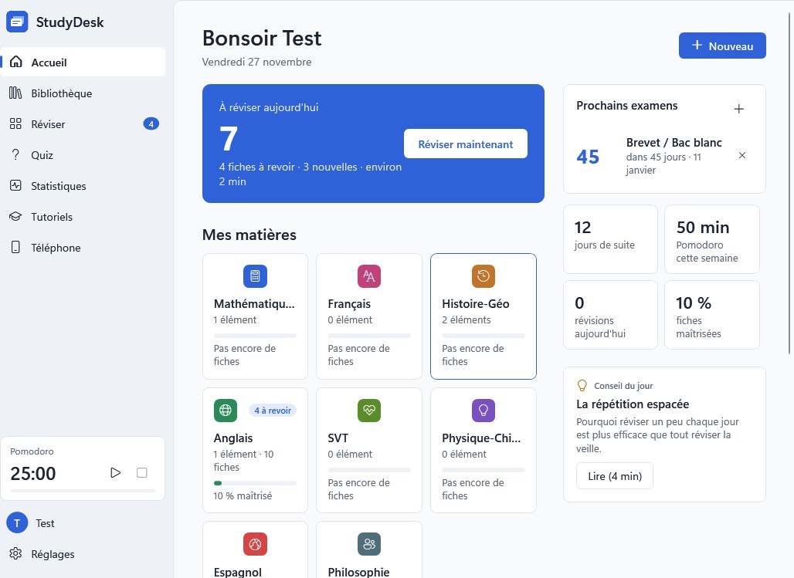

</div>

---

## Installation en 1 minute

| | |
|:-:|---|
| **1** | **[Télécharge StudyDesk.exe](https://github.com/fluxxy33/learn-app/releases/latest/download/StudyDesk.exe)**. Tu peux le ranger où tu veux, par exemple sur le Bureau. |
| **2** | **Double-clique dessus.** La première fois, Windows peut afficher « Windows a protégé votre ordinateur » : clique sur **Informations complémentaires**, puis sur **Exécuter quand même**. Ce message apparaît pour toutes les applications qui ne sont pas vendues dans le Microsoft Store. |
| **3** | **Écris ton prénom.** C'est prêt : des matières et quelques exemples sont déjà créés pour te montrer comment tout fonctionne. |

> [!TIP]
> Pour retrouver StudyDesk facilement, fais un clic droit sur `StudyDesk.exe` puis **Épingler à la barre des tâches** (ou **Afficher d'autres options › Envoyer vers › Bureau**).

**Configuration :** Windows 10 ou Windows 11, 64 bits. Pas besoin d'installer .NET ni quoi que ce soit d'autre.

**Mettre à jour :** télécharge la nouvelle version et remplace l'ancien fichier. Tes cours et tes fiches ne sont pas touchés.

**Désinstaller :** supprime `StudyDesk.exe`. Pour effacer aussi tes données, supprime le dossier `%APPDATA%\StudyDesk` (colle ce chemin dans la barre d'adresse de l'Explorateur de fichiers).

---

## Ce que tu peux faire

### 📚 Tout ranger par matière
Crée tes matières avec leur couleur et leur icône, puis des chapitres. La recherche trouve un mot même à l'intérieur de tes cours.

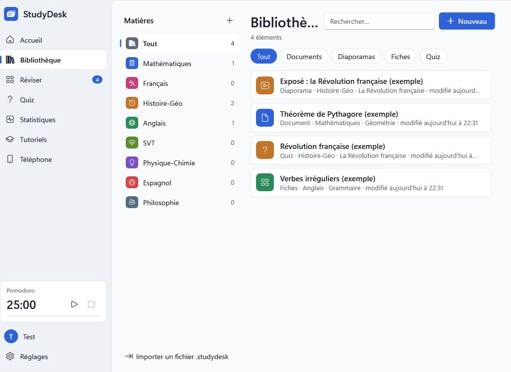

### ✏️ Écrire ses cours
Un éditeur de texte complet : titres, gras, couleurs, surlignage, listes, tableaux, encadrés « À retenir », images, dessins et schémas, correcteur orthographique, enregistrement automatique. Des modèles sont prêts à l'emploi : fiche de cours, prise de notes Cornell, dissertation, commentaire de texte, compte rendu de TP.

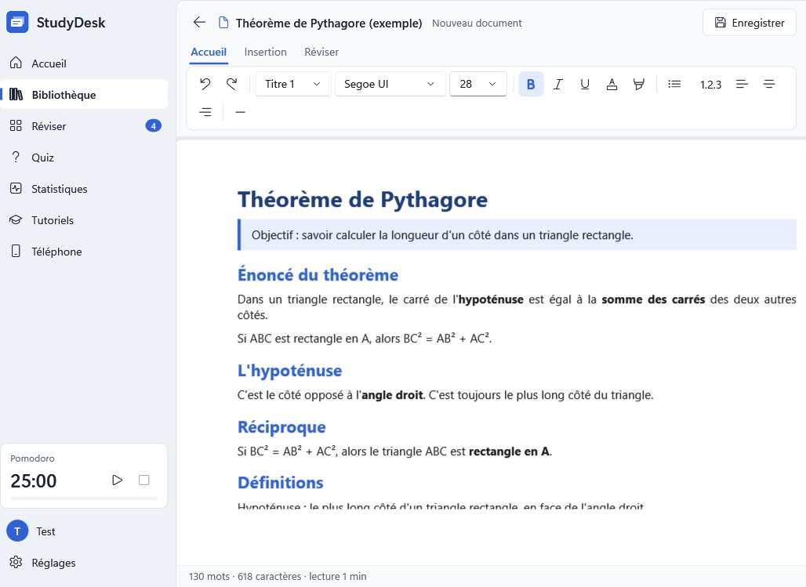

### 🖼️ Préparer un exposé
Huit thèmes, des mises en page toutes faites, des images, des formes et des flèches, le dessin à main levée, des notes pour l'oral et des transitions. Le modèle **Exposé** crée directement le plan attendu (introduction, parties, conclusion, sources), avec des conseils.

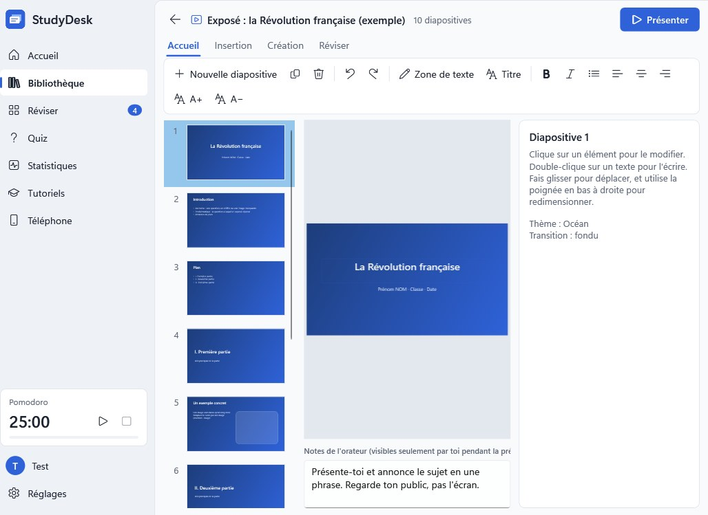

En **mode présentation** (touche F5) : flèches pour avancer, **N** pour voir tes notes, **B** pour un écran noir.

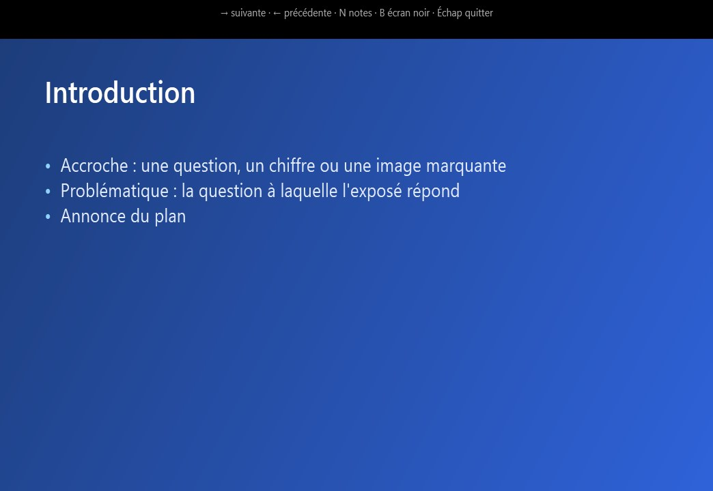

### 🃏 Réviser avec des fiches
Une question au recto, la réponse au verso, avec des images si tu veux. StudyDesk utilise la **répétition espacée** : chaque fiche revient juste avant que tu l'oublies. Tu révises moins longtemps et tu retiens beaucoup mieux.

<table>
<tr>
<td>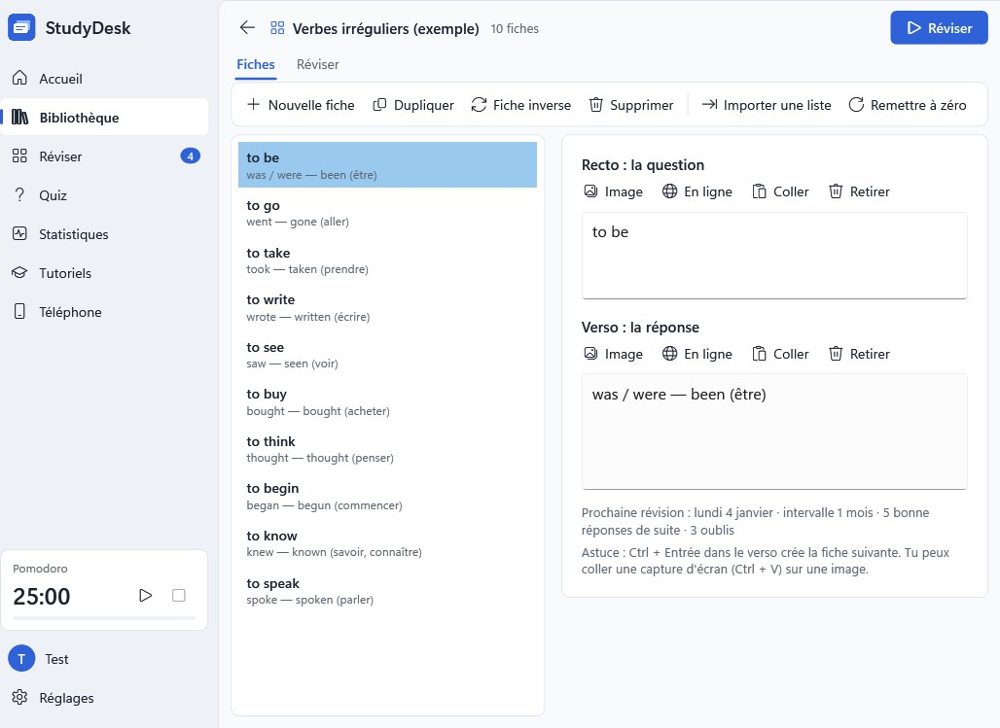</td>
<td>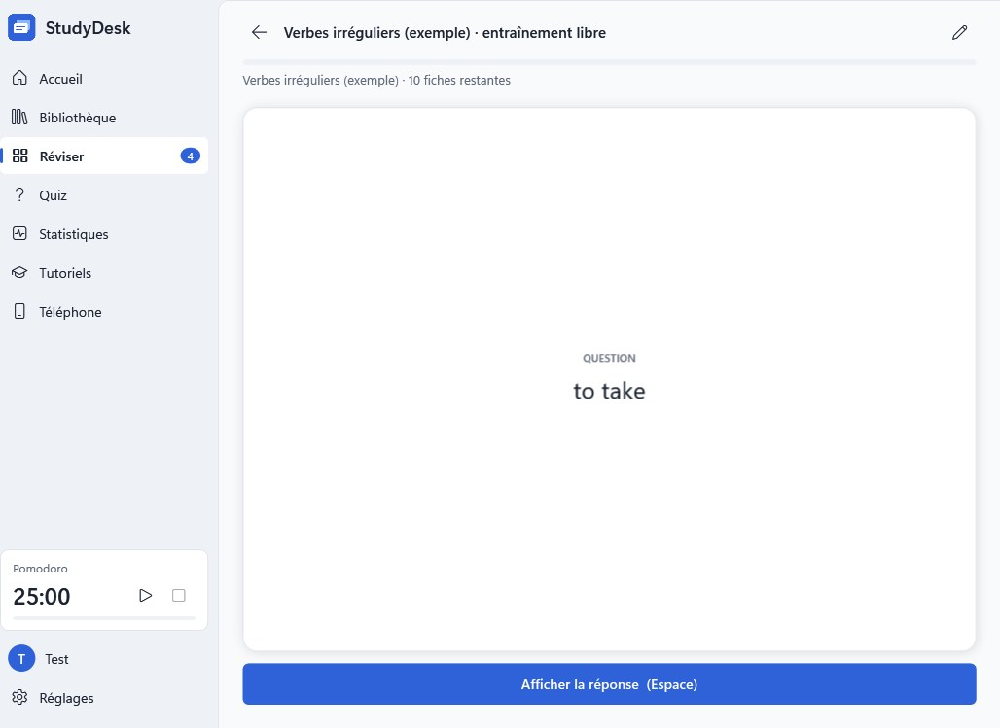</td>
</tr>
</table>

### ❓ Se tester avec des quiz
Cinq types de questions : **QCM**, **vrai / faux**, **texte à trous**, **réponse courte** (les accents et les petites fautes de frappe ne comptent pas) et **relier**. À la fin, tu vois ton score et ce qu'il faut retravailler.

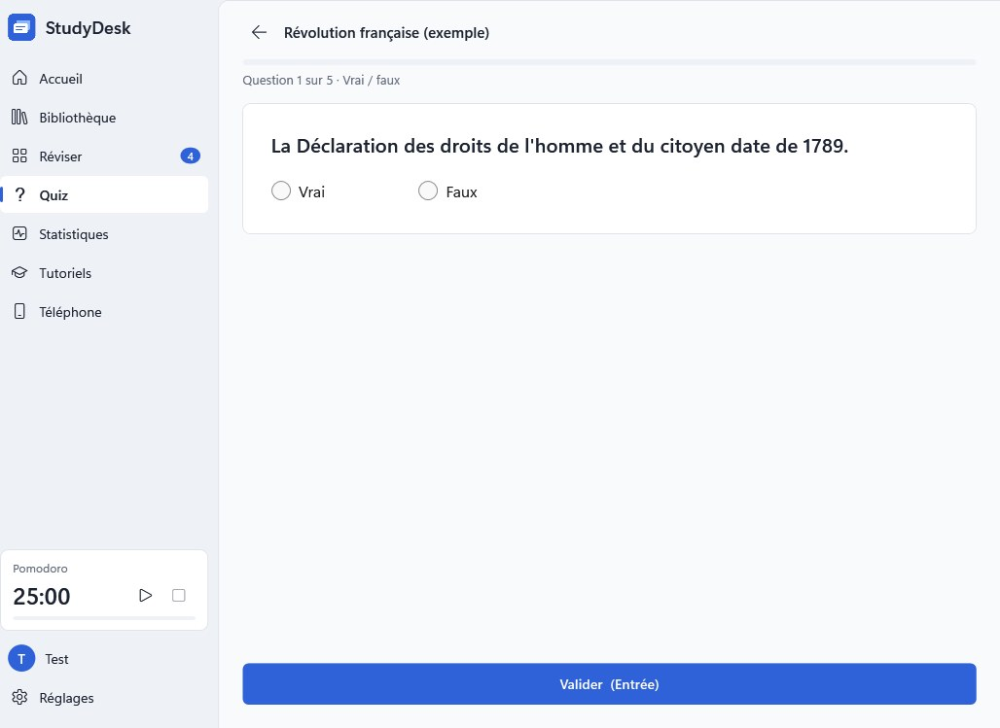

### ✨ Transformer ses cours en fiches et en quiz, automatiquement
Dans un document, l'onglet **Réviser** crée les fiches pour toi :
- chaque **titre** devient une question, et le texte qui suit en devient la réponse ;
- chaque ligne **« mot : définition »** devient une fiche ;
- chaque mot **en gras** devient un texte à trous dans un quiz.

Ça marche aussi avec les diaporamas, et un paquet de fiches peut devenir un QCM. Tout se fait sur ton PC, sans intelligence artificielle en ligne.

### 📱 Réviser sur son téléphone Android
Ouvre la page **Téléphone**, clique sur **Activer** et scanne le QR code avec l'appareil photo. Tu peux réviser tes fiches, faire tes quiz et lire tes cours dans le bus. Ta progression revient sur le PC. Il n'y a ni compte ni cloud : le téléphone parle directement au PC, sur ton Wi-Fi.

Pas de Wi-Fi ? **Créer le fichier hors ligne** te donne une page à ouvrir sur le téléphone, qui marche sans connexion.

<table>
<tr>
<td width="48%">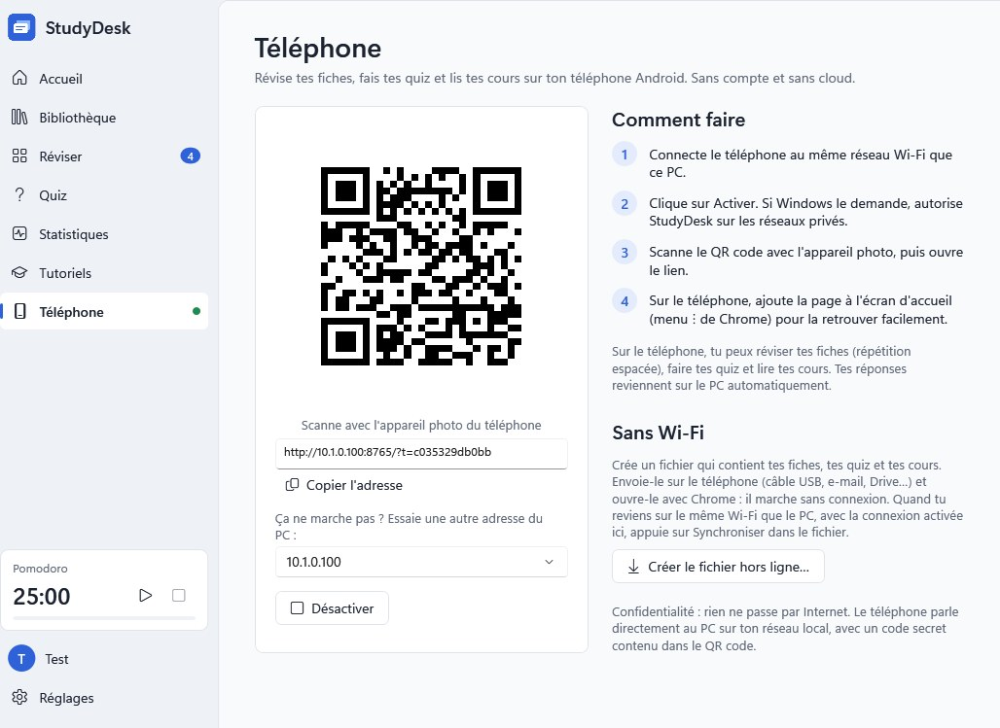</td>
<td>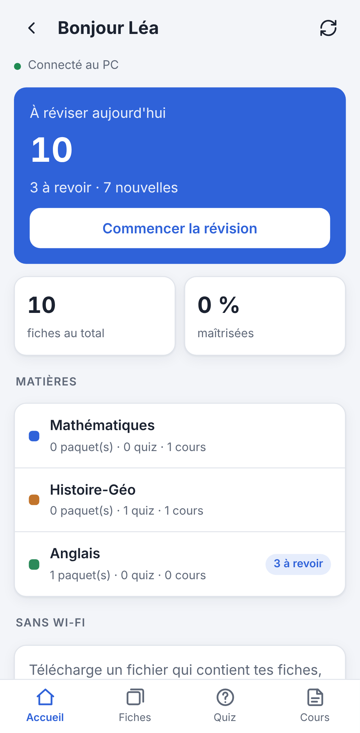</td>
<td>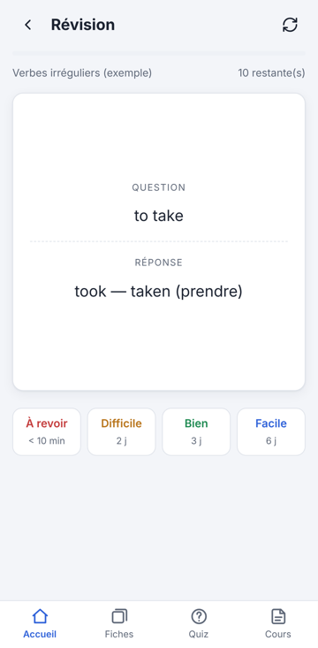</td>
<td>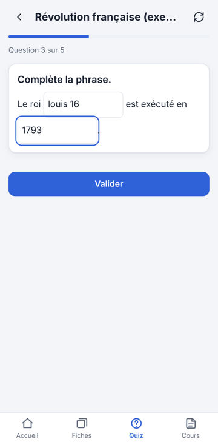</td>
</tr>
</table>

### 📈 Suivre ses progrès
Le nombre de révisions par jour, les fiches à revoir les prochains jours, les jours de travail d'affilée, le temps passé, la maîtrise de chaque matière et les résultats des quiz.

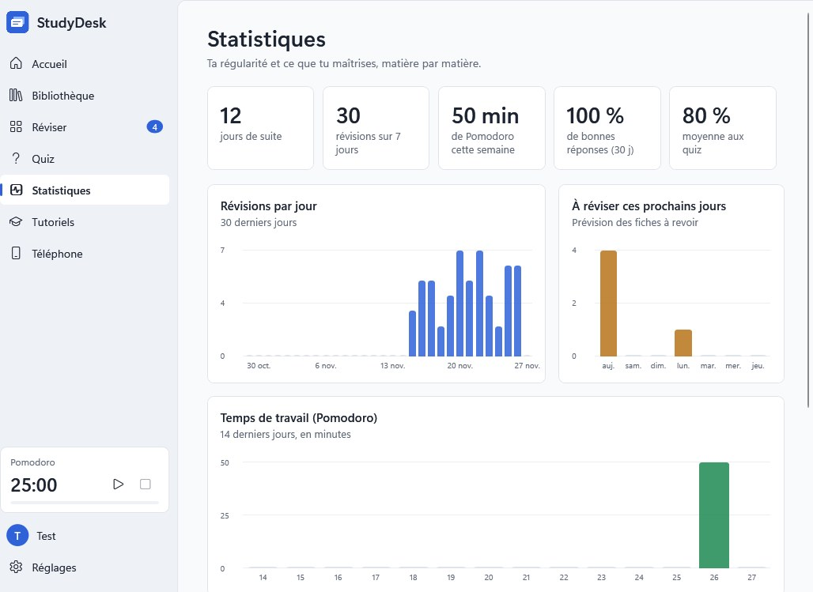

### 🎓 Apprendre à apprendre
Des tutoriels courts, avec un bouton pour essayer tout de suite : la répétition espacée, écrire de bonnes fiches, prendre des notes, réussir un exposé, structurer une dissertation, la méthode Pomodoro, planifier ses révisions…

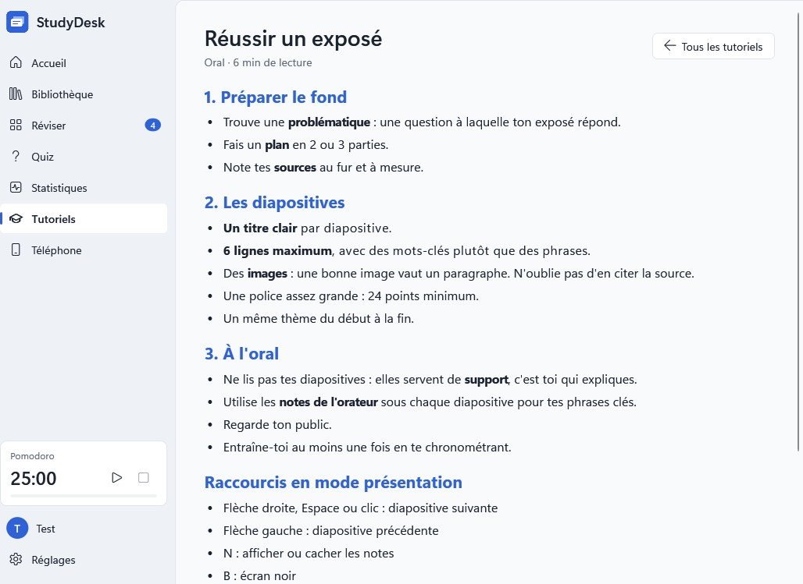

### Et aussi
- ⏱️ **Minuteur Pomodoro** toujours visible : 25 minutes de travail, 5 minutes de pause.
- 📅 **Compte à rebours** jusqu'au brevet, au bac ou aux partiels.
- 👥 **Plusieurs profils** sur le même PC, pour les frères et sœurs.
- 🌙 **Thème clair ou sombre**, ou automatique comme Windows.
- 🔗 **Partage** : envoie un cours, des fiches ou une matière entière à un ami (fichier `.studydesk`).
- 🌍 **Images et Wikipédia** (facultatif) : cherche des images libres de droits et des résumés Wikipédia ; la source est ajoutée automatiquement.

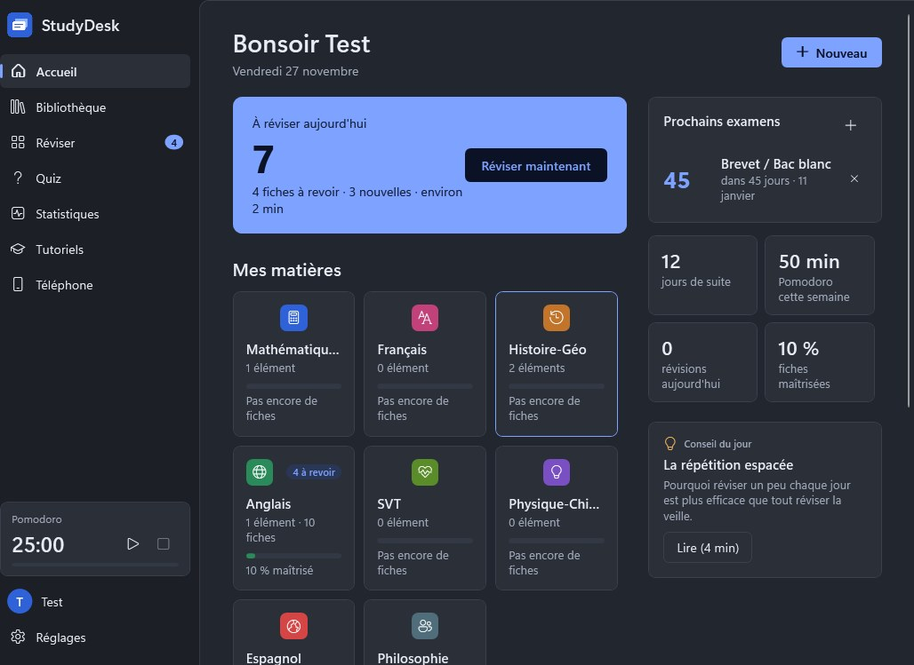

---

## Questions fréquentes

<details>
<summary><b>Faut-il Internet ?</b></summary>

Non. Tout fonctionne hors ligne. Internet sert seulement à chercher des images et des résumés Wikipédia, et tu peux désactiver ces fonctions dans les **Réglages**.
</details>

<details>
<summary><b>Où sont enregistrés mes cours ?</b></summary>

Sur ton ordinateur, dans `%APPDATA%\StudyDesk`. Rien n'est envoyé sur Internet. **Réglages › Sauvegarder** crée une copie complète dans un seul fichier `.zip`, à garder par exemple sur une clé USB.
</details>

<details>
<summary><b>Le téléphone ne trouve pas le PC</b></summary>

1. Vérifie que le téléphone et le PC sont sur le **même Wi-Fi** (pas en 4G ou 5G).
2. Au premier lancement, Windows demande d'autoriser StudyDesk sur le réseau : coche **Réseaux privés**. Si tu as refusé, va dans **Pare-feu Windows › Autoriser une application** et coche StudyDesk.
3. Sur les Wi-Fi publics ou ceux des établissements scolaires, les appareils ne peuvent souvent pas se voir. Utilise alors le **fichier hors ligne**.
4. Si ton PC a plusieurs adresses, choisis-en une autre dans la liste sous le QR code.
</details>

<details>
<summary><b>Et sur iPhone ?</b></summary>

La page s'ouvre aussi dans Safari, mais l'application est conçue et testée pour Android.
</details>

<details>
<summary><b>Windows dit que l'application n'est pas reconnue</b></summary>

C'est normal : SmartScreen se méfie des programmes qui ne sont pas signés par un éditeur payant. Clique sur **Informations complémentaires**, puis sur **Exécuter quand même**. StudyDesk est compilé automatiquement à partir du code de ce dépôt par GitHub Actions : tu peux vérifier chaque version dans l'onglet [Actions](https://github.com/fluxxy33/learn-app/actions).
</details>

---

## Pour les développeurs

| Dossier | Contenu |
|---|---|
| `src/StudyDesk.Core` | Données, répétition espacée, correction des quiz, conversions automatiques, serveur local et app téléphone (`Web/phone.html`). Bibliothèque .NET 10 indépendante de Windows. |
| `src/StudyDesk` | Application WPF (.NET 10) avec le thème Fluent de Windows 11. |
| `tests/StudyDesk.Tests` | Tests unitaires. |

```bash
dotnet test                              # tests
dotnet run --project src/StudyDesk       # lancer l'application (Windows)
```

À chaque envoi de code, GitHub Actions lance les tests, crée `StudyDesk.exe` et exécute `StudyDesk.exe --selftest`, qui ouvre chaque écran, fait des captures et vérifie l'enregistrement des documents ainsi que le serveur du téléphone. Pour publier une nouvelle version, crée un tag `vX.Y.Z` : l'exécutable est alors ajouté automatiquement aux [Releases](https://github.com/fluxxy33/learn-app/releases).
